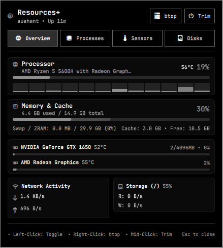

# 📊 Resources+ System Telemetry (`omarchy-plugin-resources`)

An advanced, feature-packed system monitor and hardware telemetry plugin for the Omarchy status bar.



Inspired by the compact multi-meter design of `io.github.yesm1ke.resources`, but supercharged with:
- **6-track micro-meter bar widget** (CPU, RAM, Swap, multi-vendor GPU, Storage, and live Network traffic pulse).
- **Interactive Popout Dashboard** (`KeyboardPanel`):
  - **Overview**: Real-time CPU hero card, live 12-thread per-core load strip, segmented RAM/cache bar, multi-GPU telemetry (NVIDIA + AMD + Intel), network download/upload bandwidth, and root storage I/O.
  - **Processes**: Live task manager sorted by CPU or Memory, search filter, application window indicators, and one-click process termination.
  - **Sensors**: Hardware thermal telemetry (CPU Tctl, GPU, NVMe SSD, Wi-Fi) and fan speeds in RPM.
  - **Disks**: Mounted storage filesystems with usage gauges and disk read/write throughput.
- **Quick Action Launchers**: One-click launcher for `btop` (preserving original Resources behavior on right-click), `htop`, and one-click RAM Cache Trim / Memory Compaction.
- **Rich Multi-Line Hover Tooltip**: Instant breakdown of CPU, RAM, GPU, Disk, and Network stats directly on hover without opening the panel.

## Features at a Glance

| Feature | Original Resources (`io.github.yesm1ke.resources`) | Resources+ (`sushantkr.resources`) |
|---|---|---|
| **Bar Tracks** | 4 (CPU, RAM, NVIDIA GPU, Disk) | 6 (CPU, RAM, Swap, Multi-vendor GPU, Disk, Network) |
| **GPU Support** | NVIDIA only (`nvidia-smi`) | Universal (NVIDIA, AMD Radeon, Intel) |
| **Network I/O** | ❌ None | Live download/upload bandwidth + dynamic pulse |
| **Per-Core CPU** | ❌ None | Live visual strip across all CPU cores/threads |
| **Popout Dashboard** | ❌ None (opens btop) | Complete interactive 4-tab system dashboard |
| **Task Manager** | ❌ None | Live processes by CPU/RAM + search + 1-click End Task |
| **Hardware Sensors** | ❌ None | CPU, GPU, NVMe SSD, Wi-Fi temps + active fan RPMs |
| **Memory Trim** | ❌ None | One-click pagecache drop and memory compaction |
| **Storage Inspector**| Only `/` percent | All mounted filesystems + live read/write speed |

## Controls

- **Left-Click**: Toggles the interactive Resources+ Popout Dashboard.
- **Right-Click**: Launches Activity Monitor (`btop` in terminal, same as original Resources).
- **Middle-Click**: Trims system caches and compacts RAM.
- **Hover**: Displays a real-time multi-line telemetry breakdown.
- **Esc**: Closes the popout dashboard.

## Installation & Setup

```
omarchy plugin add https://github.com/SushantKr-Me/omarchy-plugin-resources.git --enable
```

---

## License

MIT License © Sushant Kumar

